<div align="center">



</div>


## 🧑‍💻 whoami

```json
{
  "name": "Muhammad Mustafa Amir",
  "alias": "Syntrojex",
  "roles": ["Software Engineer", "Systems Developer", "Cross-Platform Engineer"],
  "education": "BS Software Engineering @ FAST-NU, Lahore",
  "currently_focusing_on": "Core Architecture, DSA & Developer Utilities",
  "focus": "Building scalable cross-platform systems & high-throughput tooling",
  "stack": ["Dart", "Flutter", "C++", "TypeScript"],
  "status": "🟢 Open to high-signal collaboration & technical systems projects"
}
```

- 🎓 Pursuing BS Software Engineering at FAST National University, Lahore (aka Syntrojex)
- ⚙️ Bridging product execution with low-level logic — Dart/Flutter cross-platform apps + C++ & TypeScript systems
- 🚀 Building production-ready software, core algorithm architectures, and automated developer tooling
- 📐 Focused on clean code, scalable design patterns, and maintainable systems


### 🎯 Core Development Focus

<table>
<tr>
<td width="160">&nbsp;&nbsp;<b>Flutter</b></td>
<td>My primary focus — building cross-platform mobile apps from UI to logic.</td>
</tr>
<tr>
<td width="160">&nbsp;&nbsp;<b>Dart</b></td>
<td>The language behind every Flutter app I ship, used daily.</td>
</tr>
<tr>
<td width="160">&nbsp;&nbsp;<b>C++</b></td>
<td>Where it all started — OOP, data structures, and algorithms built my foundation, with a growing interest in game development.</td>
</tr>
<tr>
<td width="160">&nbsp;&nbsp;<b>Assembly</b></td>
<td>Where I learned to work close to the machine — registers, memory, and raw instructions.</td>
</tr>
</table>


## ⚡ Tech Stack

<div align="center">

<h4>💻 LANGUAGES & FRAMEWORKS</h4>

<table>
<tr>
<td align="center" width="90"><br/><sub>Flutter</sub></td>
<td align="center" width="90"><br/><sub>Dart</sub></td>
<td align="center" width="90"><br/><sub>C++</sub></td>
<td align="center" width="90"><br/><sub>HTML5</sub></td>
<td align="center" width="90"><br/><sub>Assembly</sub></td>
</tr>
</table>

<h4>🧰 TOOLS & DATABASES</h4>

<table width="700" style="table-layout:fixed">
<tr>
<td align="center" width="90"><br/><sub>Firebase</sub></td>
<td align="center" width="90"><br/><sub>Supabase</sub></td>
<td align="center" width="90"><br/><sub>npm</sub></td>
<td align="center" width="90"><br/><sub>Docker</sub></td>
<td align="center" width="90"><br/><sub>GitHub</sub></td>
<td align="center" width="90"><br/><sub>Android Studio</sub></td>
<td align="center" width="90"><br/><sub>VS Code</sub></td>
<td align="center" width="90"><br/><sub>Vercel</sub></td>
<td align="center" width="90"><br/><sub>Git</sub></td>
</tr>
</table>

</div>


## 🚀 Featured Projects

<a href="https://calculin.vercel.app/"></a>
<div align="center"><a href="https://calculin.vercel.app/">Live Demo</a> · <a href="https://github.com/Syntrojex/Calculin">Repo</a></div>

<br/>

<a href="https://algostructures.vercel.app/"></a>
<div align="center"><a href="https://algostructures.vercel.app/">Live Demo</a> · <a href="https://github.com/Syntrojex/Algostructures">Repo</a></div>

<br/>

<table>
<tr>
<td width="50%">
  <a href="https://github.com/Syntrojex/ma-sfml#readme"></a>
  <br/><a href="https://github.com/Syntrojex/ma-sfml#readme">Docs</a>
</td>
<td width="50%">
  <a href="https://marketplace.visualstudio.com/items?itemName=Syntrojex.setify-cpp"></a>
  <br/><a href="https://marketplace.visualstudio.com/items?itemName=Syntrojex.setify-cpp">Marketplace</a> · <a href="https://github.com/Syntrojex/setify-cpp-vscode">Repository</a>
</td>
</tr>
</table>


## 📊 GitHub Dominance

<div align="center">


<br/>

[](https://streak-stats.demolab.com/?user=Syntrojex&theme=dark)

[](https://github.com/Syntrojex)

</div>


## 🔗 Find Me

<div align="center">

<a href="https://mustafa-amir.vercel.app"></a>
<a href="https://linkedin.com/in/mustafa-amir-syntrojex"></a>
<a href="mailto:mustafaamir398a@gmail.com"></a>
<a href="https://wa.me/923324097601"></a>
<a href="https://leetcode.com/Syntrojex"></a>

</div>


